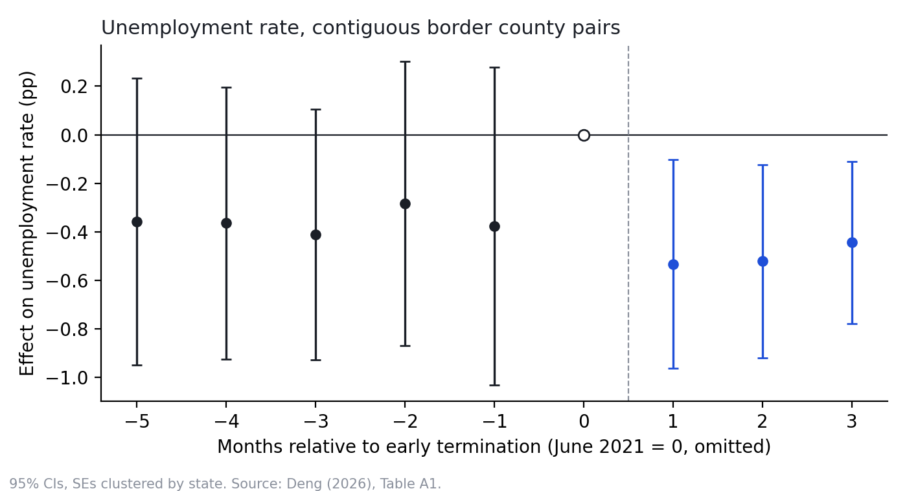
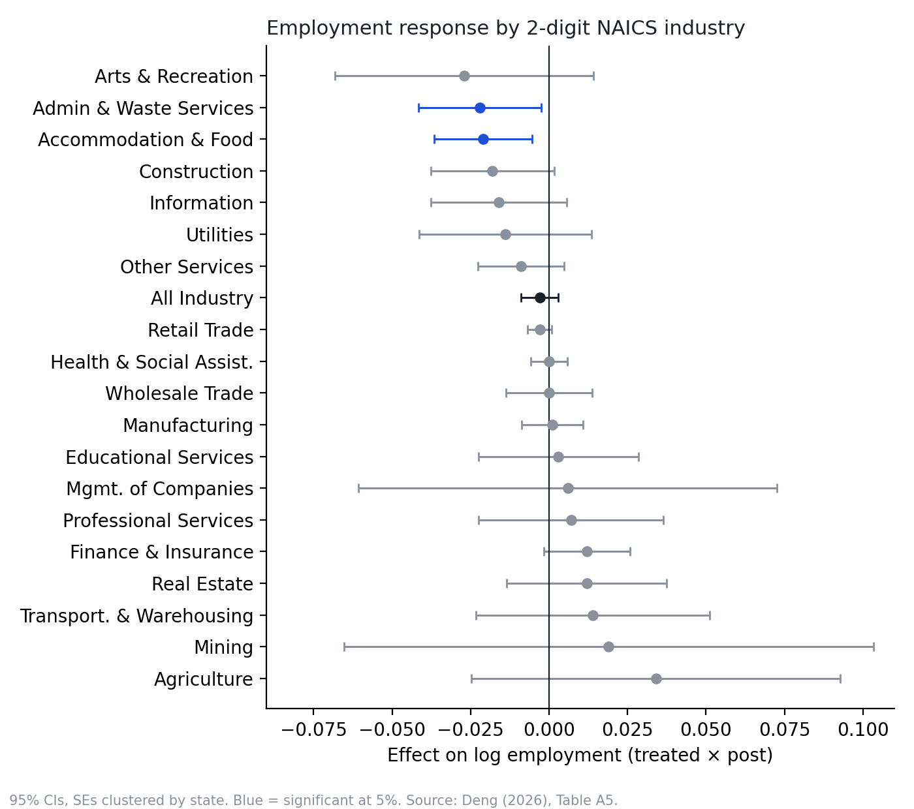

# Early Termination of Pandemic Unemployment Insurance and Local Labor Market Recovery

**A comparison of contiguous counties across state borders**

Yuhe (Maggie) Deng · Senior Thesis, B.S. Quantitative Economics, Brandeis University, May 2026
Advisors: Jiwon Choi (primary), Tymon Słoczyński (secondary), Keith Merrill (third reader)

📄 [Read the thesis (PDF)](paper/Deng_2026_Senior_Thesis.pdf) · 🏛 [Official version on Brandeis ScholarWorks](https://scholarworks.brandeis.edu/esploro/outputs/undergraduate/Early-Termination-of-Pandemic-Unemployment-Insurance/9924608628701921?institution=01BRAND_INST)

---

## Question

In mid-2021, a group of U.S. states ended the federal pandemic unemployment insurance programs (FPUC, PUA, PEUC) months before their scheduled expiry. **Did withdrawing expanded benefits speed up local labor-market recovery?**

Earlier studies mostly compare states, which mixes the policy effect with regional differences in reopening, industry mix, and recovery. This thesis compares **neighboring counties on opposite sides of a state border**, where one state ended benefits early and the other did not.

## Design

| | |
|---|---|
| **Identification** | Contiguous border county-pair (CBCP) design, following Dube, Lester & Reich (2010) |
| **Main sample** | 502 cross-border county pairs, 492 unique counties |
| **Robustness sample** | 907 "one county removed" pairs, to test for cross-border spillovers |
| **Worker-side data** | BLS Local Area Unemployment Statistics (LAUS), monthly |
| **Business-side data** | BLS Quarterly Census of Employment and Wages (QCEW), quarterly, all 2-digit NAICS sectors |
| **Weights** | 2020 Census population ÷ number of pairs a county appears in |
| **Inference** | Standard errors clustered by state (county clustering in the appendix) |

Event-study specification:

$$
Y_{ipt} = \sum_{k \neq 0} \beta_k \, D_i \cdot \mathbf{1}\{t - T = k\} + \alpha_i + \gamma_{pt} + \varepsilon_{ipt}
$$

County fixed effects $\alpha_i$ absorb fixed local characteristics. **Pair-by-period fixed effects** $\gamma_{pt}$ absorb any shock common to both sides of a border pair in a given month or quarter, so identification comes only from the state-policy difference within each pair.

## Findings

<p align="center"></p>

1. **Unemployment fell modestly.** The unemployment rate declined by about 0.53 pp after early termination (significant at 5%), with no detectable change in employment-to-population or labor-force participation. Because the unemployed are a small stock relative to the employed, this is roughly 190 people per average county, or about 0.56% of employment.
2. **The headline effect likely overstates the response.** Pre-period coefficients are already negative (average −0.36 pp). Netting them out, in the spirit of Rambachan & Roth (2023), leaves about −0.17 pp. With county-level clustering, the pre-trends become significant.
3. **No broad business-side expansion.** QCEW shows no meaningful post-policy change in establishments, employment, or wages for the private sector overall, and the alternative-pair robustness check agrees.
4. **Low-wage sectors did not drive the adjustment.** This contradicts the pure labor-supply story. Accommodation & food and admin & waste services show *negative* employment effects, and labor-intensive wages fell. The pattern fits weak labor demand or reallocation toward higher-quality matches better than a low-wage hiring boom.

<p align="center"></p>

**Bottom line:** early termination had modest, uneven effects, more consistent with limited reallocation than with a sharp low-wage hiring rebound.

## Repository structure

```
├── paper/
│   └── Deng_2026_Senior_Thesis.pdf
├── code/
│   ├── 00_master.do                         # runs everything in order; set $root here
│   ├── 01_data_setup/
│   │   ├── population_setup.do              # 2020 Census county population
│   │   ├── LAUS_data_setup.do               # monthly LAUS panel
│   │   └── QCEW_data_setup.do               # quarterly QCEW panel, all 2-digit NAICS
│   ├── 02_samples/
│   │   ├── all_county_sample.do             # all counties, Figure B1
│   │   ├── contig_sample.do                 # 502 contiguous border county pairs
│   │   ├── pseudo_sample.do                 # 907 alternative comparison pairs
│   │   └── sample_maps.do                   # Figure 1
│   ├── 03_descriptives/
│   │   ├── descriptive_table.do             # Table 1
│   │   ├── balance_test.do                  # Table 2
│   │   └── AC_balance_test.do               # Table B1
│   ├── 04_main_analysis/
│   │   ├── contig_county_pair.do            # Figures 2, 4, 5; Tables A1, A3, A4
│   │   ├── contig_qcew_all_industry.do      # Figure 3
│   │   └── mostly_affected_ind.do           # Figure 10, Table A5
│   └── 05_robustness/
│       ├── robustness_check.do              # Figures 6, 8, 9; Table A2
│       ├── robustness_qcew_all_industry.do  # Figure 7
│       ├── all_county_sample_analysis.do    # Appendix B
│       └── county_clustering.do             # Appendix C
├── data/
│   └── README.md                            # what to download and where to put it
└── output/
    └── figures/                             # headline figures shown above
```

## Reproducing the results

1. **Download the raw data** listed in [`data/README.md`](data/README.md) into `data/`. Raw files are public but large, so they are not stored in this repository.
2. **Install the Stata packages** (Stata 17+): `reghdfe`, `ftools`, `estout`, `coefplot`, `listtab`, `listtex`, `maptile`, `spmap`. The install commands are at the top of `code/00_master.do`.
3. **Set the root path** in `code/00_master.do`:
   ```stata
   global root "/path/to/pandemic-ui-early-termination"
   ```
4. **Run** `do code/00_master.do`. Tables and figures are written to `output/`.

## How the samples are built

- **Contiguous border pairs** (`contig_sample.do`): from the Census county adjacency file, keep county pairs that touch across a state line where exactly one state ended benefits early. Alaska and Hawaii are excluded.
- **Alternative comparison pairs** (`pseudo_sample.do`): for each border pair A–B, take a neighbor C of A and a neighbor F of B. C must be in A's state and F in B's. Neither C nor F may sit on the treated/control border, and C and F must not touch. This compares counties one step inland on each side, which tests whether the main results are driven by cross-border spillovers such as commuting.

Because a county can belong to several pairs, every regression weights by population ÷ number of pair appearances.

## Citation

```bibtex
@thesis{deng2026earlyui,
  author = {Deng, Yuhe},
  title  = {Early Termination of Pandemic Unemployment Insurance and Local Labor Market Recovery: A Comparison of Contiguous Counties Across State Borders},
  school = {Brandeis University},
  type   = {Senior Thesis},
  year   = {2026}
}
```

## Contact

Maggie Deng · [LinkedIn](http://www.linkedin.com/in/maggie-deng-52314a2b3) · [GitHub](https://github.com/dengyuhe)
